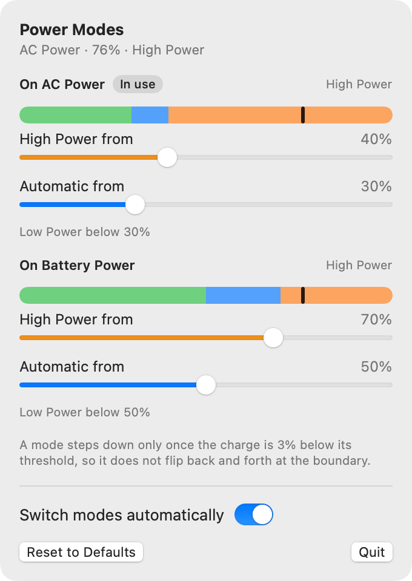

# Power Modes

A macOS menu bar app that switches the power mode (Low Power, Automatic or High Power) from the battery charge, with separate thresholds for AC and battery power.



## What it does

- Each power source has two sliders: the minimum charge for High Power and the minimum charge for Automatic. Anything below the Automatic minimum is Low Power.
- A mode steps up as soon as the charge reaches its threshold, and steps down only once the charge is 3 points below it, so it does not flip back and forth at a boundary.
- The display does not dim when the mode changes.
- Both profiles are kept current, so plugging in or unplugging lands in the right mode straight away.
- Turning off "Switch modes automatically" leaves the modes as they are and greys out the sliders.

Default thresholds:

| Battery charge | On AC Power | On Battery Power |
| --- | --- | --- |
| 0–20% | Low Power | Low Power |
| 21–50% | Automatic | Low Power |
| 51–79% | Automatic | Automatic |
| 80–100% | High Power | Automatic |

## Install

Needs a Mac laptop and the Swift toolchain (Xcode or its command line tools). The build targets macOS 14 or later. It has only been tested on an Apple silicon MacBook Pro, and High Power needs a Mac that offers that mode.

```sh
./scripts/install-app.sh
```

This builds the app, copies it to `~/Applications/Power Modes.app`, and adds a launch agent so it starts at login.

Then click **Install Helper…** in the popover, or run:

```sh
sudo ./scripts/install-helper.sh
```

Changing the power mode needs root, so this installs a small root-owned helper and a sudoers rule that lets your account run only that helper's twelve fixed mode commands without a password.

To remove everything, run `./scripts/uninstall.sh`, then `sudo ./scripts/uninstall.sh`.

## Caveats

- The no-dim switch uses a private CoreBrightness API, so it may stop working after a macOS update. If it cannot take its brightness lock, the mode change is refused and the popover shows the error.

More detail on the helper, hysteresis, checks and layout is in [docs/details.md](docs/details.md).
